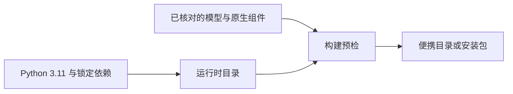

# Windows 构建说明

## 快速理解

同一份源码可以生成便携目录或安装包。
便携版把数据库放在自身的 `data\product-v1.db`。
安装版允许选择软件目录。
安装版把数据库放在 `%LOCALAPPDATA%\BetterPianoTrans\product-v1.db`。

## 核心流程



## 构建输入

| 输入 | 要求 |
| --- | --- |
| Windows 运行时 | Python 3.11 x64。包版本见 `requirements-windows-cu128.txt`。 |
| 模型 | Zenodo 4034264 的 checkpoint。哈希见 `assets.sha256`。 |
| SoundFont | MuseScore General 0.2.0 SF3。哈希见 `assets.sha256`。 |
| FFmpeg | 8.1.2 LGPL 构建。源码与方法见 `third_party/ffmpeg/BUILD_AND_SOURCE.md`。 |
| FluidSynth 组件 | 2.6.0 的 `libfluidsynth-3.dll`，及测试包对应的 `SDL3.dll`、`sndfile.dll`。 |
| 安装器 | Inno Setup 6 的 `ISCC.exe`。只生成安装版时需要。 |

把模型和组件放入一个私有目录。
目录结构须与 `assets.sha256` 的相对路径一致。
可以用现有测试包的 `app` 目录作为已核对输入。
构建脚本会逐个检查 SHA-256。

## 可运行命令

在仓库根目录运行以下 PowerShell 命令。
将测试包路径换成你的实际路径。

```powershell
.\tools\prepare_windows_runtime.ps1
.\tools\build_windows.ps1 -Kind Portable `
  -RuntimeSource .\work\runtime `
  -AssetsRoot 'D:\FL Product\Better_PianoTrans_test\app' `
  -CheckOnly
.\tools\build_windows.ps1 -Kind Portable `
  -RuntimeSource .\work\runtime `
  -AssetsRoot 'D:\FL Product\Better_PianoTrans_test\app'
```

便携版输出到 `outputs\BetterPianoTrans-portable`。
运行 `BetterPianoTrans.cmd` 启动。
诊断入口是 `BetterPianoTrans-Diagnostics.cmd`。

安装版使用同一运行时和素材。
把 ISCC 路径改成你的实际安装位置。

```powershell
.\tools\build_windows.ps1 -Kind Installer `
  -RuntimeSource .\work\runtime `
  -AssetsRoot 'D:\FL Product\Better_PianoTrans_test\app' `
  -InnoCompiler 'C:\Program Files (x86)\Inno Setup 6\ISCC.exe'
```

安装器输出到 `outputs\BetterPianoTrans-installer\setup`。
安装向导允许你更改软件目录。
无论软件装在哪，数据库都在当前 Windows 账户的数据目录。

## 来源与发行边界

依赖清单锁定了测试包里的 Python 包版本。
它不包含 Python 安装包本身的哈希。
也未锁定每个 wheel 的下载哈希。
安装器工具也要单独取得。
这份流程目前是可检查的构建起点。
还需验证干净机器上的安装、升级和卸载。
还需完成二进制许可证与源码交付核对。

## 常见问题

**Q：预检报哈希不符怎么办？**
A：停止构建。核对文件来源和版本。
不要直接改清单来放行未知文件。

**Q：能用 Python 3.14 吗？**
A：当前锁定 Python 3.11 x64。
脚本会拒绝其他版本。

## 排错指南

若依赖检查失败，先核对 `pip freeze`。
若窗口打不开，运行诊断入口查看报错。
若安装器缺失，传入正确的 `ISCC.exe` 路径。
